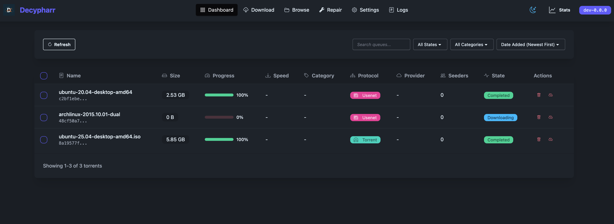

# Decypharr



**Decypharr** is a **Media Gateway** for Debrid services and Usenet written in Go.

## What is Decypharr?

Decypharr provides a unified interface for Sonarr, Radarr, and other *Arr applications to access Debrid providers and
Usenet streaming.

## Features

- Mock Qbittorent and Sabnzbd API that supports the Arrs (Sonarr, Radarr, Lidarr etc)
- Multiple Debrid and usenet providers support with a single interface
- Direct Usenet streaming via NNTP (no separate download client required)
- Read-only NFSv4 and SMB servers for the same libraries, including custom virtual folders

## Supported Debrid Providers

- [Real Debrid](https://real-debrid.com)
- [Torbox](https://torbox.app)
- [Debrid Link](https://debrid-link.com)
- [All Debrid](https://alldebrid.com)
- [Premiumize](https://www.premiumize.me)

## Quick Start

### Docker (Recommended)

```yaml
services:
  decypharr:
    image: cy01/blackhole:latest
    container_name: decypharr
    ports:
      - "8282:8282"
      # Optional: NFSv4 (when NFS is enabled in Settings)
      # - "2049:20490/tcp"
      # Optional: SMB — Windows clients require host port 445 (when SMB is enabled in Settings)
      # - "445:1445/tcp"
    volumes:
      - /mnt/:/mnt:rshared
      - ./configs/:/app # config.json must be in this directory
    restart: unless-stopped
    devices:
      - /dev/fuse:/dev/fuse:rwm
    cap_add:
      - SYS_ADMIN
    security_opt:
      - apparmor:unconfined
```

> Prefer not to self-host? A managed Decypharr instance is available
> via [ElfHosted](https://store.elfhosted.com/product/decypharr/?utm_source=github&utm_medium=readme&utm_campaign=decypharr-readme),
> preconfigured alongside Sonarr/Radarr to route requests to your debrid provider (7-day trial).

## Documentation

For complete documentation, please visit our [Documentation](https://docs.decypharr.com).

## Contributing

Contributions are welcome! Please feel free to submit a Pull Request.

## License

This project is licensed under the MIT License. See the [LICENSE](LICENSE) file for details.

## GUI development

The GUI uses React, Vite, and Bun. React Router Data mode declares the routes in
`web/src/app/router.tsx`, with a shared `<Outlet />` layout and a session loader.
Pages, components, and API behavior live together under `web/src/domains`.
The small fetch wrapper in `web/src/shared/api/client.ts` handles the deployment
prefix, JSON, cookies, and errors. TanStack Query owns server data, deduplication,
polling, and mutation invalidation. Domain `*.queries.ts` files declare query keys
and options, and the owning components call `useQuery` and `useMutation` directly.

Query defaults live in `web/src/app/query-client.ts`. Reads use a short freshness
window and at most one retry for network/server errors; mutations never retry or
queue themselves for later execution when offline. Repair actions invalidate the
repair views, and settings drafts stay local so refetches cannot replace unsaved
edits. The route loader checks authentication afresh and clears protected cached
data when the session is no longer authorized.

```sh
bun install --frozen-lockfile
bun run build
# Start the Go backend using your normal development configuration, then:
bun run dev
```

Vite serves the GUI at `http://localhost:5173` and proxies API requests to `http://localhost:8282`. Set `DECYPHARR_BACKEND_URL` to change the
backend address. The development proxy assumes the backend uses the default
`url_base` of `/`; use the Go-served build when checking a custom URL prefix.

Run `bun run check` for TypeScript checks and `bun run test:web` for frontend tests.
For browser smoke tests, install Chromium with `cd web && bunx playwright install chromium`,
then run `bun run build` and `bun run test:browser` from the repository root. These
tests use mock API responses and exercise every route at both `/` and `/base/`.

Production builds must run `bun run build` **before** `go build`. Go embeds
`web/dist` and serves it on the same origin as the API, using the configured
`url_base` at runtime. Docker and standalone release workflows build these assets
automatically; the deployed application does not need Bun or Node.js. Responsive
layout improvements are a separate follow-up.
