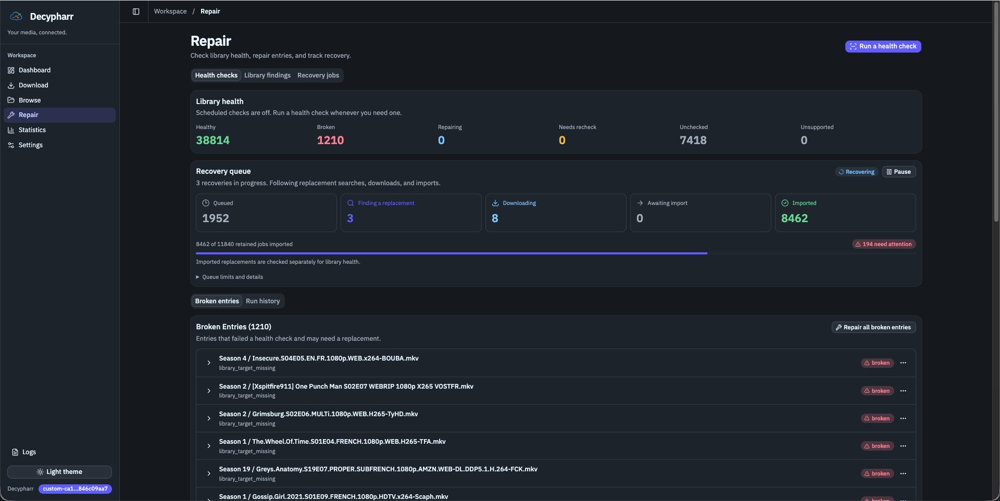
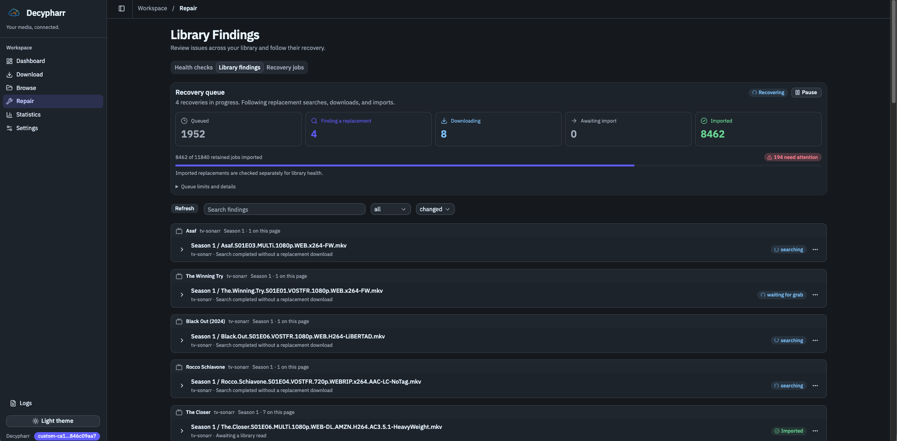
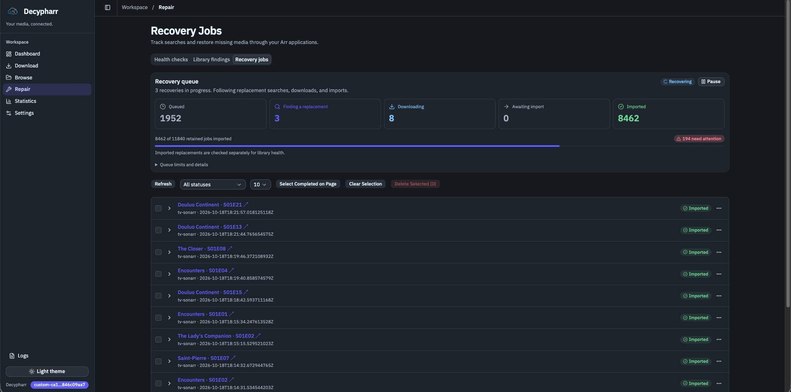

# React UI and library audit/recovery improvements — interested in upstream contributions?

Hi @sirrobot01, thanks for building Decypharr!

I've been extending it for my setup, mainly to detect broken library symlinks and recover media through Sonarr/Radarr. That work grew into several backend improvements and a React UI, so I wanted to discuss the direction before opening PRs.

The changes are in [ioeldev/decypharr on ioel/beta](https://github.com/ioeldev/decypharr/tree/ioel/beta). The main additions are:

- **Library read audits:** check imported Sonarr/Radarr files through their actual library paths, including symlinks whose original torrent is no longer tracked. Supports scheduled full audits and persistent findings with recheck and repair controls.
- **Recovery queue:** persistent jobs and retries, dispatch pacing, concurrency limits, pause/resume, and visibility into downloads, imports, and confirmed readability.
- **Season-aware recovery:** prefer Sonarr season packs with episode fallback, plus optional whole-season replacement.
- **Cache recovery:** handle explicit cache rejections and optionally fall back to uncached downloads on supported providers.
- **React UI:** replaces the Go templates with React/Vite, with responsive layouts and updated repair views. Production assets remain embedded in the Go binary; no separate frontend service is needed.

This is preview work. Audits sample-read files rather than validating complete media, and repair actions can replace files through Arr. The frontend also changes the build pipeline, so I'd treat it separately from the backend contributions.

**Would any of these changes fit your plans for Decypharr?** In particular, I'd be interested in your thoughts on library auditing/recovery independently of the React migration.

For anything you'd like upstream, I can work toward focused PRs with the relevant tests and documentation. Which area and target branch would you prefer starting with?

I'm maintaining the preview as **Decypharr — ioel fork**, with separate builds and issue reporting, while keeping the upstream attribution clear. The [README](https://github.com/ioeldev/decypharr/blob/ioel/beta/README.md) includes installation instructions, and the [repair guide](https://github.com/ioeldev/decypharr/blob/ioel/beta/docs/src/content/docs/guides/repair.mdx) describes the audit/recovery behavior.

Thanks for your thoughts!

### Screenshots

These are from my running setup, taken at different times.

**Health checks and recovery overview**

**Library findings and recovery status**

Recovery jobs

